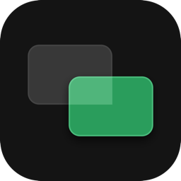
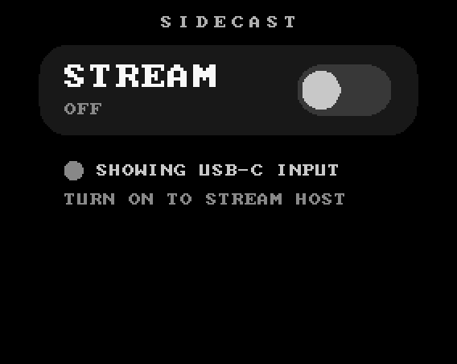
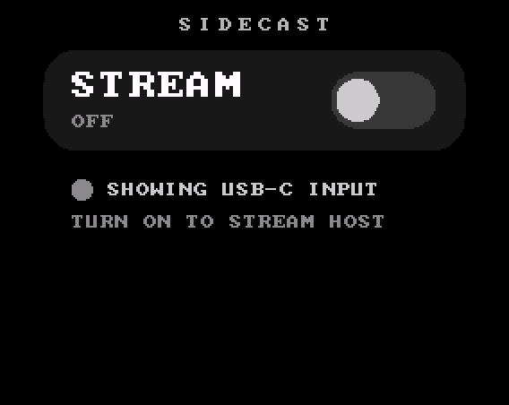
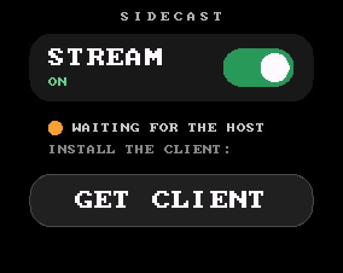
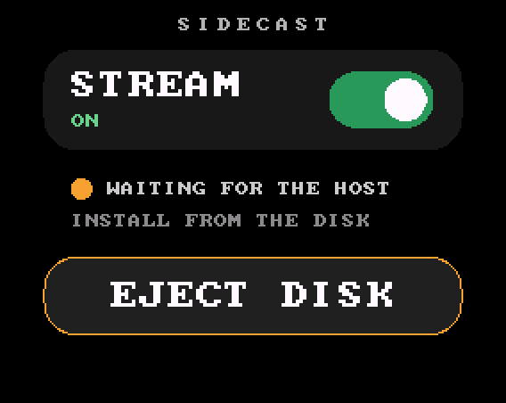
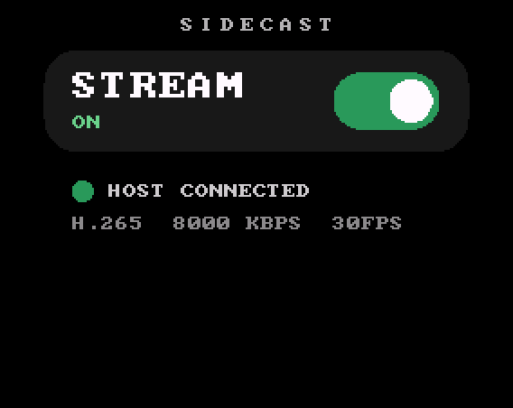
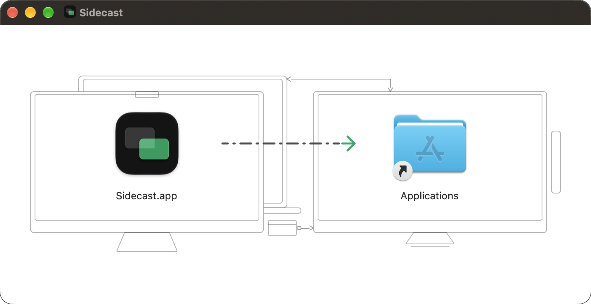
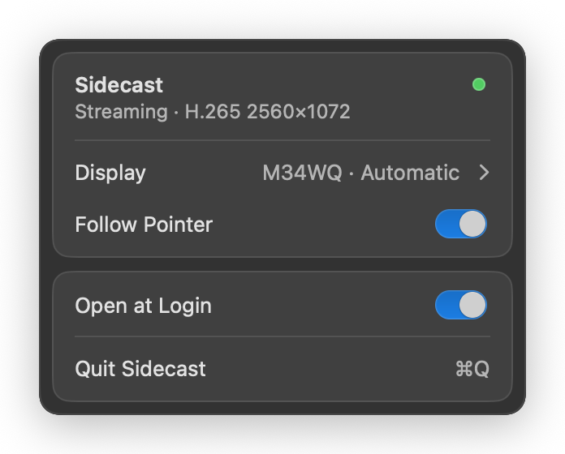

<p align="center"></p>

<h1 align="center">Sidecast</h1>

<p align="center">
  <b>The V in KVM, from any monitor.</b><br>
  Stream your computer's own displays into a NanoKVM Go or Go+ over the USB link it uses for keyboard and mouse.<br>
  No video cable, no display output given up.
</p>

<p align="center">
  <a href="../../releases/latest">Download</a> ·
  <a href="#get-started">Get started</a> ·
  <a href="#how-it-works">How it works</a> ·
  <a href="docs/protocol.md">Write a client</a>
</p>

---

The NanoKVM Go and Go+ take video through USB-C DisplayPort Alt Mode: the computer has to drive a display
output into the KVM, and the KVM sees only that one display. Sidecast streams the computer's own displays
instead, over the USB network link the KVM already uses for keyboard and mouse. Open the KVM's web UI as
usual, and the screen you work on is there.

Any operating system can stream to Sidecast: the protocol is open and small. Every release ships a signed,
notarized Mac app and a Windows app; on Linux, a few lines around ffmpeg will do (see
[Write a client](#write-a-client)).

## Requirements

| Component | Requirement |
|:---|:---|
| KVM | NanoKVM Go or Go+ running the `nanokvm-go` version named in the release (today: 0.2.2) |
| Mac app | Apple silicon, macOS 13 or later |
| Windows app | x64 or Arm, Windows 10 version 2004 or later, a hardware H.264 or H.265 encoder |
| Other systems | any client that follows [the protocol](docs/protocol.md) |
| Link | the USB-C cable between the computer and the KVM |

## What it unlocks

- **The V in KVM, from any monitor.** Stream a laptop's built-in screen or any external display, not only
  a display the computer drives for the KVM.
- **No display output needed.** A computer at its external-display limit cannot give the KVM a video signal
  at all; with Sidecast it does not have to, and one that could keeps that output for a monitor.
- **Everything on the KVM keeps working.** Keyboard and mouse, H.264 or H.265, bitrate, frame rate and
  keyframe interval: change them in the web UI and the client follows live.
- **Quiet when nobody is watching.** The KVM tells the client when the last viewer leaves (after about 15
  seconds) and when one returns, so it streams only while someone is looking.
- **Installs from the KVM itself.** Tap **GET CLIENT** and the KVM shows the computer a disk holding the
  client installers.
- **Fully reversible.** Switch STREAM off and the KVM is exactly as shipped, capturing USB-C again.

The Mac app adds:

- **Any display, or the one you are pointing at.** Pick a display from the menu bar, or turn on **Follow
  Pointer**: the stream follows the pointer, and holding it against an edge carries you onto the next
  display, as if you were sitting at the Mac.
- **Clicks land where you look.** When a viewer arrives, the pointer moves onto the streamed display.
- **Wakes the displays** when you start viewing. Your input keeps them awake; the lock screen still asks for
  your password.
- **No recording indicator** in the menu bar by default, and a low-CPU mode if you would rather have it.

The Windows app adds:

- **Any display, from the notification area.** Pick a display in its flyout. Windows sends the KVM's mouse only
  to the primary display, so the display you pick becomes the primary while Sidecast runs, and the KVM's
  pointer works there. Quitting puts your own layout back.
- **Your PC's hardware encoder**, on x64 and on Arm, the way the Mac app uses the Mac's.

## On the KVM

One switch, one status line, and a button when there is something to do.

<p align="center">
  <br>
  <sub>Recorded from the panel: switching STREAM on, installing the client from the KVM's disk, and the computer connecting.</sub>
</p>

<div align="center">
<table>
  <tr>
    <td align="center"></td>
    <td align="center"></td>
  </tr>
  <tr>
    <td align="center"><sub>Off: the KVM captures USB-C as usual</sub></td>
    <td align="center"><sub>On, computer plugged in: one tap to install</sub></td>
  </tr>
  <tr>
    <td align="center"></td>
    <td align="center"></td>
  </tr>
  <tr>
    <td align="center"><sub>Installer disk on the computer</sub></td>
    <td align="center"><sub>Streaming, with the KVM's current settings</sub></td>
  </tr>
</table>
</div>

## Get started

> [!IMPORTANT]
> Each release supports exactly one `nanokvm-go` version, named in the first line of its release notes.
> Sidecast checks the KVM's version and refuses to switch on under any other, so match the release to your
> KVM.

### Install on the KVM

1. Download `Sidecast-vX.Y.Z-nanokvm.zip` from the [latest release](../../releases/latest). Keep it
   zipped.
2. In the KVM's web UI, open **Settings > Apps**, choose **Upload ZIP**, pick the file and confirm
   **Install**. Sidecast appears on the device's Apps page within 10 seconds.
3. Open **Sidecast** on the device and tap the STREAM card. The KVM's server restarts with Sidecast loaded.

### Install on a Mac

4. Tap **GET CLIENT** on the KVM. A disk named "Sidecast" appears on the Mac; macOS asks once to allow the
   new USB accessory. The disk holds one installer per platform: open `Sidecast-<version>-macos-arm64.dmg`.
5. Drag Sidecast to Applications and open it. Allow Screen Recording when asked.

   

6. Tap **EJECT DISK** on the KVM. Within a minute the KVM's web UI shows your Mac.

Sidecast starts at login from then on and reconnects whenever the cable is plugged in.

### Install on Windows

4. Tap **GET CLIENT** on the KVM. A drive named "Sidecast" appears in File Explorer. It holds one installer
   per platform: open `Sidecast-<version>-windows-x64.exe`, or `-windows-arm64.exe` on an Arm PC
   (**Settings > System > About** shows which under **System type**).
5. The installer needs no administrator rights and starts Sidecast in the notification area when it finishes.
6. Tap **EJECT DISK** on the KVM, then pick the display to stream from Sidecast's icon. Within a minute the
   KVM's web UI shows it.

> [!NOTE]
> The Windows app is not signed yet. If Windows says it protected your PC when you open the installer, choose
> **More info**, then **Run anyway**.

Sidecast starts with Windows from then on and reconnects whenever the cable is plugged in.

### Updating

> [!WARNING]
> The KVM will not install over an installed App. Remove Sidecast under **Settings > Apps** first, then
> upload the newer zip, then switch STREAM off and on so the KVM loads the newer shim.

On the Mac, open the newer DMG from the KVM's disk, or download it from the `Clients` release, and replace
the app. On Windows, run the newer installer from either place: it updates Sidecast in place.

## The Mac app

The menu bar icon opens a small panel: a status light (streaming well, idle with no viewer, degraded, or
not streaming), the display to stream, **Follow Pointer**, **Open at Login**, and **Quit**.

<p align="center">
  
</p>

<details>
<summary><b>Command-line options</b></summary>

Run the app's binary once with `--install` and the options you want. They are saved, and the Login Item
picks them up:

```
/Applications/Sidecast.app/Contents/MacOS/Sidecast --install --sck
```

| Option | Effect | Default |
|:---|:---|:---|
| `--sck` / `--no-sck` | capture through ScreenCaptureKit: about a fifth of the CPU, but macOS shows its recording indicator | `--no-sck` |
| `--follow` / `--no-follow` | Follow Pointer on or off | `--no-follow` |
| `--display main\|<name>` | display to stream (`--list` prints the names) | `main` |
| `--width N` | stream width | `2560` |
| `--kvm <address>` | the KVM's address over USB | `10.136.177.1` |

</details>

## The Windows app

Sidecast's icon in the notification area opens a flyout: the same status light, the display to stream,
**Start with Windows**, and **Quit**. The display you pick is the primary while Sidecast runs, and it stays the
primary if Windows rearranges the displays (a monitor plugged in, or a change in Settings). Quit, or uninstall,
and Windows goes back to your own layout.

<details>
<summary><b>Uninstall</b></summary>

On the Mac, run `Sidecast.app/Contents/Resources/Uninstall.command` (right-click the app, **Show Package
Contents**) or `Sidecast --uninstall`, then move the app to the Trash.

On Windows, uninstall Sidecast under **Settings > Apps > Installed apps**. It puts your own display layout
back and removes its settings.

On the KVM, switch STREAM off, then remove Sidecast under **Settings > Apps**.

</details>

## How it works

```
Host screen ─capture + encode─▶ USB network link ──▶ Sidecast shim in the KVM server ──▶ your browser
  (client)                         (TCP 5555)        (stock library underneath)
```

- **The shim** (`app/shim/`) stands in for the KVM server's video library. It forwards every call to the
  stock library, so the KVM behaves as shipped, and while a client is connected it serves video from the
  network instead. A text channel on the same connection tells the client which codec, bitrate, frame rate
  and keyframe interval the web UI asks for, when to pause, and when to send a keyframe.
- **The device app** (`app/sidecast/`) is the touchscreen app above. It switches the shim on and off and
  serves the installer disk to the computer over USB.
- **A client** on the computer captures a display, encodes it and streams it. The Mac app uses the Mac's
  hardware encoder and ships signed and notarized; the Windows app uses the PC's hardware encoder through
  Media Foundation. Anything that follows [the protocol](docs/protocol.md) works the same way.

## Limits

- The computer must be booted, logged in and running a client. This is remote desktop through the KVM's
  own pipeline, not out-of-band access; the KVM's USB-C capture still covers other machines.
- No audio. The link is USB 2.0, so only encoded video crosses it.
- The ready-made clients are the Mac app, for Apple silicon, and the Windows app, for x64 and Arm. Other
  systems need a client built on the protocol; the ffmpeg recipe is the quickest start.
- On Windows, the KVM's mouse reaches only the primary display, so the streamed display is the primary while
  Sidecast runs, and the pointer cannot follow you to another display as it does on the Mac.
- Supported on the NanoKVM Go and Go+, one `nanokvm-go` version per release.

## Write a client

The protocol is small and open: one TCP connection, plain-text control lines from the KVM, an Annex-B
video stream from the host. [docs/protocol.md](docs/protocol.md) has everything needed, including an ffmpeg
recipe for a quick Linux client.

## Releases

| Release | Tag | Asset |
|:---|:---|:---|
| Device app and shim | `vX.Y.Z` | `Sidecast-vX.Y.Z-nanokvm.zip` |
| Clients | `client-vX.Y.Z` | `Sidecast-vX.Y.Z-macos-arm64.dmg`, `Sidecast-vX.Y.Z-windows-arm64.exe`, `Sidecast-vX.Y.Z-windows-x64.exe` |

Each device app release names the `nanokvm-go` version it supports in the first line of its notes, and
carries every installer of the client release named in `version.toml` on its installer disk. Changes are listed in
[CHANGELOG.md](CHANGELOG.md).

<details>
<summary><b>Building from source</b></summary>

- **Shim**, from `app/shim/`:

  ```
  docker run --rm --platform linux/arm/v7 -v "$PWD":/src -w /src debian:trixie-20260918-slim sh -c \
    'apt-get -qq update && apt-get -qq install -y gcc libc6-dev && gcc -O2 -shared -fPIC -Wl,-soname,libkvm.so.0 -o libkvm.so libkvm_shim.c -ldl -lpthread'
  ```

- **Shim self-check**, from `app/shim/`:

  ```
  cc -O1 -o test_shim test_shim.c -lpthread && ./test_shim test.h264 test.h265 test_vt.h264
  ```

- **Device app:** `./build.sh [deploy <kvm-host>]` assembles `build/sidecast` and, with `deploy`, copies it
  to `/kvmcomm/apps/` over ssh. Versions come from `version.toml`: the app's, the supported `nanokvm-go`,
  and the client release whose installers it puts on the installer disk (`SIDECAST_CLIENTS=<dir>` takes every
  `Sidecast-v*` installer in a folder instead, such as a client build's `build/`). Builds other than the tagged release add the commit to the version. Needs
  `xorriso`, or `hdiutil` on a Mac.
- **Preview** the device app without hardware: `app/render-states.py <appbase dir> app/sidecast <out dir>`.
  The SDK's `appbase.py` is on the KVM at `/kvmcomm/apps/`; copy it to `dev/appbase/` (never committed).
- **Release:** bump `version.toml`, add the version's section to `CHANGELOG.md`, commit, and tag `vX.Y.Z`.
  CI checks they agree, builds the shim and the app, and publishes the zip.

</details>

## License

The shim, the device app and the protocol in this repository are [MIT licensed](LICENSE). The Mac and
Windows apps, on the KVM's installer disk and in the `Clients` releases, are separate closed-source binaries:
free to use and to redistribute unmodified.
